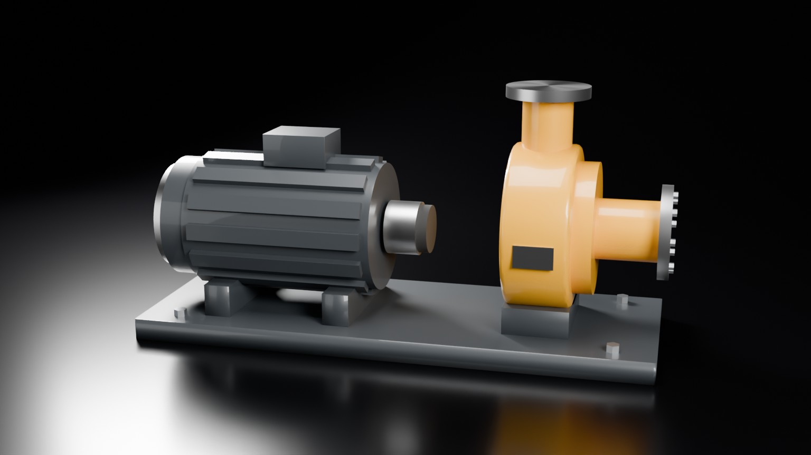
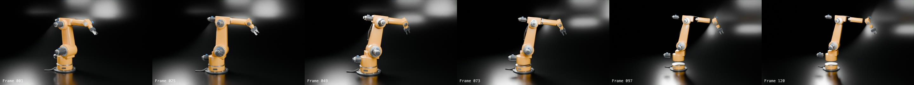
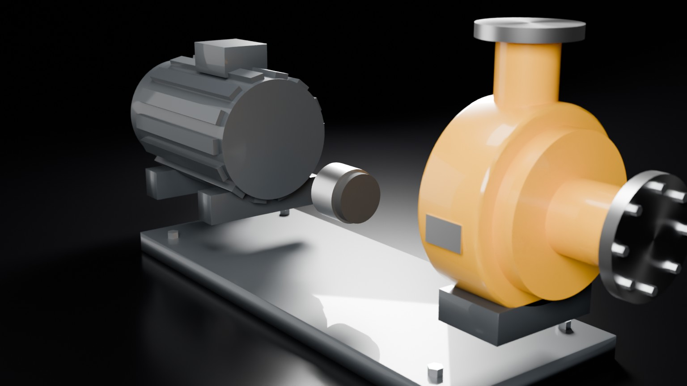

<p align="center">
  
</p>

<h1 align="center">Blender Product Video</h1>

<p align="center">
  Una skill per <a href="https://claude.com/claude-code">Claude Code</a> che porta da foto, link, file CAD o disegni tecnici a un video 3D di prodotto finito,<br>
  con storyboard, anteprime, grafiche, voce fuori campo, musica, effetti sonori e file di consegna.
</p>

<p align="center">
  <a href="https://mariomele.github.io/blender-product-video/"><b>Pagina del progetto</b></a> ·
  <a href="#installazione">Installazione</a> ·
  <a href="blender-product-video/README.md">Documentazione completa</a>
</p>

<p align="center">
  
</p>

---

## Cos'è

Una skill che guida Claude Code, e te, in tutto il percorso di un video 3D di prodotto: macchine, impianti, componenti, processi industriali. Pensata per presentazioni commerciali, contenuti social, fiere e siti.

- **Parte da qualsiasi sorgente:** CAD (GLB, STEP via export, STL, OBJ…), foto, la pagina web del prodotto, disegni tecnici e schizzi quotati.
- **Fa domande a ogni fase** e si ferma per un'approvazione prima di andare avanti, così le correzioni arrivano quando costano poco.
- **Si ricorda dove sei:** tutte le decisioni finiscono in `progetto.md`, e una richiesta come "rifai l'intro" porta direttamente alla fase giusta.
- **Render su GPU Metal** con controllo anti-blocco, render ripartibili e la possibilità di rifare solo i frame cambiati.

## Esempi

Tutte le immagini qui sotto sono generate con gli script della skill, partendo da un prodotto dimostrativo modellato proceduralmente ([`build_pump.py`](docs/assets/examples/build_pump.py)).

### Stesso prodotto, tre ambientazioni
Nel brief scegli dove deve stare il prodotto: studio nero, limbo, capannone, esterno, showroom. Puoi partire anche da una foto di riferimento.

| Studio nero | Limbo | Capannone |
|---|---|---|
|  |  |  |

### Storyboard: un frame al secondo
Prima di ogni anteprima animata, una griglia con un frame al secondo (compreso l'ultimo) mostra subito inquadrature e movimenti. Esce in pochi secondi.



### Movimenti e materiali
Esplosi, montaggi, parti in movimento; materiali fisici con colori reali (RAL/Pantone) e finiture procedurali.

| Vista esplosa | Dettaglio materiali |
|---|---|
|  |  |

## Il percorso

| # | Fase | Cosa ottieni |
|---|---|---|
| 0 | **Brief** | formato, durata, ambiente e atmosfera, palette delle infografiche, salvati in `progetto.md` |
| 1 | **Il pezzo** | modello in scala reale, materiali e ambientazione, mostrati in viste statiche |
| 2 | **Le scene** | per ognuna: storyboard 1 fps, poi anteprima a 24, 12 o 6 fps |
| 3 | **Montaggio** | tutte le scene in un'anteprima unica, con i tempi in `timings.json` |
| 4 | **Grafiche e testo** | titoli, callout, misure e sottotitoli in [HyperFrames](https://github.com/heygen-com/hyperframes) |
| 5 | **Audio** | voce, musica ed effetti con [ElevenLabs](https://elevenlabs.io/mcp); scene adattate alla voce |
| 6 | **Visione d'insieme** | il video completo in bozza, da approvare |
| 7 | **Render finale** | Cycles su GPU Metal, con stima dei tempi e notifica a fine render |
| 8 | **Rifare un pezzo** | solo i frame cambiati |
| 9 | **Consegna** | `master.mp4` a −14 LUFS, `light.mp4` sotto i 28 MB, `sottotitoli.srt` |

I dettagli di ogni fase, gli script e l'elenco di montaggio (EDL) sono nella [documentazione completa](blender-product-video/README.md).

## Installazione

### 1. La skill

```bash
git clone https://github.com/mariomele/blender-product-video.git
cp -r blender-product-video/blender-product-video ~/.claude/skills/
```

Riavvia Claude Code: la skill si attiva da sola quando chiedi un video 3D di un prodotto.

### 2. Le dipendenze

Sistema: macOS con Apple Silicon (provato su M1 Pro). Python 3 è già incluso in macOS.

| Dipendenza | Serve per | Installazione |
|---|---|---|
| [Claude Code](https://claude.com/claude-code) | eseguire la skill | vedi il link |
| [Blender 5.1 o successivo](https://www.blender.org/download/) | modello, scene, render | scarica e sposta in `/Applications` (altro percorso: variabile `BLENDER`) |
| [Blender MCP (Blender Lab)](https://www.blender.org/lab/mcp-server/) | far lavorare Claude dentro Blender | 1) add-on in Blender, seguendo la pagina; 2) server MCP: il pacchetto `.mcpb` dalla [pagina release](https://projects.blender.org/lab/blender_mcp/releases) si apre con Claude Desktop, oppure si installa da sorgente con la [guida di setup](https://projects.blender.org/lab/blender_mcp/wiki/Setup) |
| [Homebrew](https://brew.sh) + [FFmpeg](https://ffmpeg.org) | anteprime, montaggio, consegna | `brew install ffmpeg` (include ffprobe) |
| [Node.js 22+](https://nodejs.org/en/download) | HyperFrames | installer dal link, oppure `brew install node` |
| [HyperFrames](https://github.com/heygen-com/hyperframes) | grafiche, testi, mix audio | `claude plugin marketplace add heygen-com/hyperframes` poi `claude plugin install hyperframes@hyperframes` |
| [ElevenLabs MCP](https://elevenlabs.io/mcp) | voce, musica, effetti sonori | `claude mcp add --transport http elevenlabs https://api.elevenlabs.io/v1/mcp`, poi `/mcp` in Claude Code per accedere |
| [Blender skills](https://github.com/arjun988/blender-skills) | skill di supporto (blender-director, materials, lighting, lookdev, camera-cinematography, environment-artist…) | istruzioni nel README del repo |

Facoltativi:
- [Firecrawl MCP](https://docs.firecrawl.dev/mcp-server): leggere pagine prodotto e ricavare la palette da un sito (in alternativa Claude usa il browser integrato).
- Un account [ElevenLabs](https://elevenlabs.io) con crediti, per voce, musica ed effetti.
- [Machine skill](https://github.com/AirsupHQ/machine-skill): solo se vuoi anche la pagina 3D interattiva extra (esploso, sezione, numeri di funzionamento). `git clone https://github.com/AirsupHQ/machine-skill.git ~/.claude/skills/machine`

### 3. Verifica rapida

```bash
/Applications/Blender.app/Contents/MacOS/Blender --version
ffmpeg -version | head -1
node -v
```

## Come si usa

Basta chiederlo a Claude Code, per esempio:

- "Fammi un video 3D di questo prodotto, ti allego il CAD"
- "Ho queste foto della macchina, voglio un video per Instagram"
- "Rifai l'intro con la camera più bassa"
- "Aggiungi voce fuori campo e musica"
- "Prepara i file da consegnare"

## Struttura del repo

```
blender-product-video/      la skill (da copiare in ~/.claude/skills/)
  SKILL.md                  istruzioni per Claude
  README.md                 documentazione completa
  scripts/                  import, anteprime, render, voce, sottotitoli, consegna
  evals/                    casi di prova del comportamento
docs/                       pagina del progetto (GitHub Pages), logo, immagini di esempio
```

## Licenza

[MIT](LICENSE)
