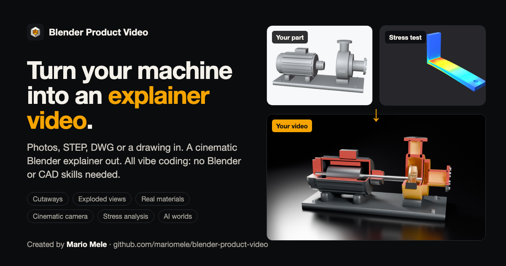
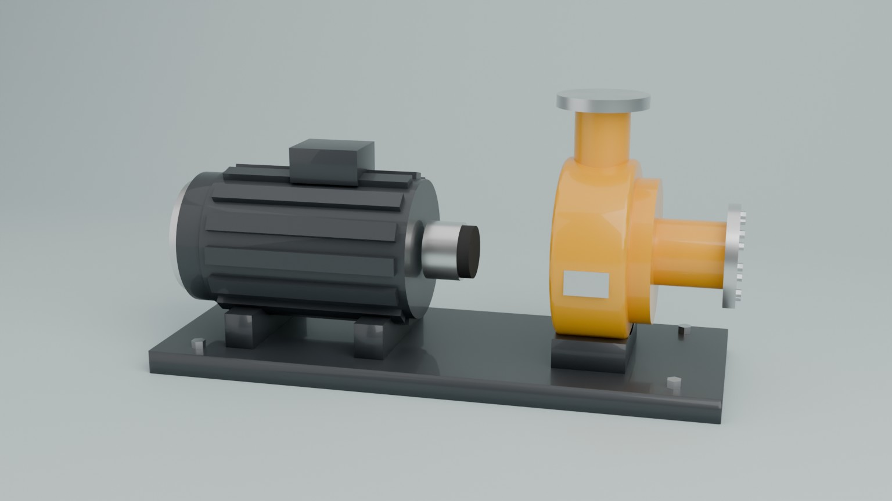
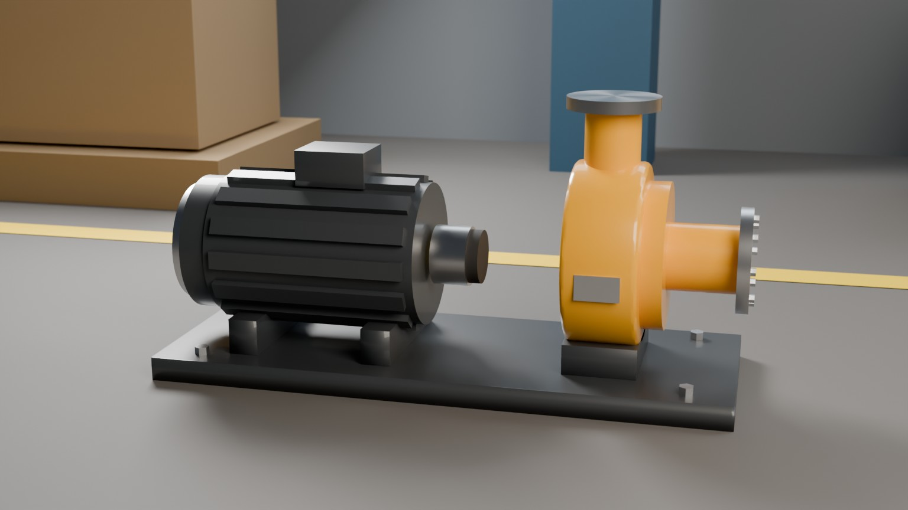

<p align="center">
  
</p>

<h1 align="center">Blender Product Video</h1>

<p align="center">
  A <a href="https://claude.com/claude-code">Claude Code</a> skill that takes photos, a link, CAD files or technical drawings to a finished 3D product video,<br>
  with storyboard, previews, motion graphics, voice-over, music, sound effects and delivery files.
</p>

<p align="center"><i>
  Una skill per Claude Code che porta da foto, link, file CAD o disegni tecnici a un video 3D di prodotto finito,<br>
  con storyboard, anteprime, grafiche, voce fuori campo, musica, effetti sonori e file di consegna.
</i></p>

<p align="center">
  <a href="https://mariomele.github.io/blender-product-video/"><b>Project page</b></a> ·
  <a href="#english">English</a> ·
  <a href="#italiano">Italiano</a> ·
  <a href="blender-product-video/README.md">Full docs (IT)</a>
</p>

<p align="center">
  
</p>

---

## Examples · Esempi

Every image below was made with the skill's scripts, from a procedurally modelled demo product ([`build_pump.py`](docs/assets/examples/build_pump.py)).
*Tutte le immagini sono generate con gli script della skill, partendo da un prodotto dimostrativo modellato proceduralmente.*

| Black studio · Studio nero | Limbo | Warehouse · Capannone |
|---|---|---|
|  |  |  |

**Storyboard, one frame per second · Storyboard, un frame al secondo**


| Exploded view · Vista esplosa | Material detail · Dettaglio materiali |
|---|---|
|  |  |

---

<a id="english"></a>
## English

> The skill talks to you in Italian: its questions, notes and full documentation are in Italian. Claude Code understands requests in any language.

### What it is

A skill that guides Claude Code, and you, through the whole making of a 3D product video: machines, plants, components, industrial processes. Built for sales presentations, social content, trade fairs and websites.

- **Starts from any source:** CAD (GLB, STEP via export, STL, OBJ…), photos, the product's web page, technical drawings and dimensioned sketches.
- **Asks questions at every phase** and stops for your approval before moving on, so fixes come when they are cheap.
- **Remembers where you are:** every decision goes into `progetto.md`, and a request like "redo the intro" jumps straight to the right phase.
- **Renders on Metal GPU** with a hang watchdog, resumable renders and the option to redo only the frames that changed.

### The phases

| # | Phase | What you get |
|---|---|---|
| 0 | **Brief** | format, length, environment and mood, infographic palette, saved in `progetto.md` |
| 1 | **The product** | real-scale model, materials and environment, shown as still views |
| 2 | **The scenes** | for each one: 1 fps storyboard, then a preview at 24, 12 or 6 fps |
| 3 | **Edit** | all scenes in one preview, with timings in `timings.json` |
| 4 | **Graphics and text** | titles, callouts, dimensions and subtitles in [HyperFrames](https://github.com/heygen-com/hyperframes) |
| 5 | **Audio** | voice, music and sound effects with [ElevenLabs](https://elevenlabs.io/mcp); scenes fitted to the voice |
| 6 | **Full review** | the complete draft video, for approval |
| 7 | **Final render** | Cycles on Metal GPU, with a time estimate and a notification when done |
| 8 | **Redo a part** | only the frames that changed |
| 9 | **Delivery** | `master.mp4` at −14 LUFS, `light.mp4` under 28 MB, `sottotitoli.srt`; optional interactive 3D page |

### Install

**1. The skill**

```bash
git clone https://github.com/mariomele/blender-product-video.git
cp -r blender-product-video/blender-product-video ~/.claude/skills/
```

Restart Claude Code: the skill turns on by itself when you ask for a 3D product video.

**2. Dependencies**

System: macOS on Apple Silicon (tested on M1 Pro). Python 3 ships with macOS.

| Dependency | Used for | Install |
|---|---|---|
| [Claude Code](https://claude.com/claude-code) | running the skill | see the link |
| [Blender 5.1 or later](https://www.blender.org/download/) | model, scenes, render | download and move to `/Applications` (other path: `BLENDER` variable) |
| [Blender MCP (Blender Lab)](https://www.blender.org/lab/mcp-server/) | letting Claude work inside Blender | 1) the add-on in Blender, following the page; 2) the MCP server: the `.mcpb` package from the [releases page](https://projects.blender.org/lab/blender_mcp/releases) opens with Claude Desktop, or install from source with the [setup guide](https://projects.blender.org/lab/blender_mcp/wiki/Setup) |
| [Homebrew](https://brew.sh) + [FFmpeg](https://ffmpeg.org) | previews, edit, delivery | `brew install ffmpeg` (includes ffprobe) |
| [Node.js 22+](https://nodejs.org/en/download) | HyperFrames | installer from the link, or `brew install node` |
| [HyperFrames](https://github.com/heygen-com/hyperframes) | graphics, text, audio mix | `claude plugin marketplace add heygen-com/hyperframes` then `claude plugin install hyperframes@hyperframes` |
| [ElevenLabs MCP](https://elevenlabs.io/mcp) | voice, music, sound effects | `claude mcp add --transport http elevenlabs https://api.elevenlabs.io/v1/mcp`, then `/mcp` in Claude Code to sign in |
| [Blender skills](https://github.com/arjun988/blender-skills) | support skills (blender-director, materials, lighting, lookdev, camera-cinematography, environment-artist…) | instructions in the repo README |

Optional:
- [Firecrawl MCP](https://docs.firecrawl.dev/mcp-server): read product pages and pull a palette from a website (otherwise Claude uses the built-in browser).
- An [ElevenLabs](https://elevenlabs.io) account with credits, for voice, music and effects.
- [Machine skill](https://github.com/AirsupHQ/machine-skill): only for the extra interactive 3D page (exploded view, section, working numbers). `git clone https://github.com/AirsupHQ/machine-skill.git ~/.claude/skills/machine`

**3. Quick check**

```bash
/Applications/Blender.app/Contents/MacOS/Blender --version
ffmpeg -version | head -1
node -v
```

### How to use it

Just ask Claude Code, for example:

- "Make a 3D video of this product, CAD attached"
- "I have these photos of the machine, I want a video for Instagram"
- "Redo the intro with a lower camera"
- "Add voice-over and music"
- "Prepare the delivery files"

### Repo layout

```
blender-product-video/      the skill (copy it to ~/.claude/skills/)
  SKILL.md                  instructions for Claude
  README.md                 full documentation (Italian)
  scripts/                  import, previews, render, voice, subtitles, delivery
  evals/                    behaviour test cases
docs/                       project page (GitHub Pages), logo, sample images
```

### License

[MIT](LICENSE)

---

<a id="italiano"></a>
## Italiano

### Cos'è

Una skill che guida Claude Code, e te, in tutto il percorso di un video 3D di prodotto: macchine, impianti, componenti, processi industriali. Pensata per presentazioni commerciali, contenuti social, fiere e siti.

- **Parte da qualsiasi sorgente:** CAD (GLB, STEP via export, STL, OBJ…), foto, la pagina web del prodotto, disegni tecnici e schizzi quotati.
- **Fa domande a ogni fase** e si ferma per un'approvazione prima di andare avanti, così le correzioni arrivano quando costano poco.
- **Si ricorda dove sei:** tutte le decisioni finiscono in `progetto.md`, e una richiesta come "rifai l'intro" porta direttamente alla fase giusta.
- **Render su GPU Metal** con controllo anti-blocco, render ripartibili e la possibilità di rifare solo i frame cambiati.

### Il percorso

| # | Fase | Cosa ottieni |
|---|---|---|
| 0 | **Brief** | formato, durata, ambiente e atmosfera, palette delle infografiche, salvati in `progetto.md` |
| 1 | **Il pezzo** | modello in scala reale, materiali e ambientazione, mostrati in viste statiche |
| 2 | **Le scene** | per ognuna: storyboard 1 fps, poi anteprima a 24, 12 o 6 fps |
| 3 | **Montaggio** | tutte le scene in un'anteprima unica, con i tempi in `timings.json` |
| 4 | **Grafiche e testo** | titoli, callout, misure e sottotitoli in [HyperFrames](https://github.com/heygen-com/hyperframes) |
| 5 | **Audio** | voce, musica ed effetti con [ElevenLabs](https://elevenlabs.io/mcp); scene adattate alla voce |
| 6 | **Visione d'insieme** | il video completo in bozza, da approvare |
| 7 | **Render finale** | Cycles su GPU Metal, con stima dei tempi e notifica a fine render |
| 8 | **Rifare un pezzo** | solo i frame cambiati |
| 9 | **Consegna** | `master.mp4` a −14 LUFS, `light.mp4` sotto i 28 MB, `sottotitoli.srt`; pagina 3D interattiva facoltativa |

I dettagli di ogni fase, gli script e l'elenco di montaggio (EDL) sono nella [documentazione completa](blender-product-video/README.md).

### Installazione

**1. La skill**

```bash
git clone https://github.com/mariomele/blender-product-video.git
cp -r blender-product-video/blender-product-video ~/.claude/skills/
```

Riavvia Claude Code: la skill si attiva da sola quando chiedi un video 3D di un prodotto.

**2. Le dipendenze**

Sistema: macOS con Apple Silicon (provato su M1 Pro). Python 3 è già incluso in macOS.

| Dipendenza | Serve per | Installazione |
|---|---|---|
| [Claude Code](https://claude.com/claude-code) | eseguire la skill | vedi il link |
| [Blender 5.1 o successivo](https://www.blender.org/download/) | modello, scene, render | scarica e sposta in `/Applications` (altro percorso: variabile `BLENDER`) |
| [Blender MCP (Blender Lab)](https://www.blender.org/lab/mcp-server/) | far lavorare Claude dentro Blender | 1) add-on in Blender, seguendo la pagina; 2) server MCP: il pacchetto `.mcpb` dalla [pagina release](https://projects.blender.org/lab/blender_mcp/releases) si apre con Claude Desktop, oppure si installa da sorgente con la [guida di setup](https://projects.blender.org/lab/blender_mcp/wiki/Setup) |
| [Homebrew](https://brew.sh) + [FFmpeg](https://ffmpeg.org) | anteprime, montaggio, consegna | `brew install ffmpeg` (include ffprobe) |
| [Node.js 22+](https://nodejs.org/en/download) | HyperFrames | installer dal link, oppure `brew install node` |
| [HyperFrames](https://github.com/heygen-com/hyperframes) | grafiche, testi, mix audio | `claude plugin marketplace add heygen-com/hyperframes` poi `claude plugin install hyperframes@hyperframes` |
| [ElevenLabs MCP](https://elevenlabs.io/mcp) | voce, musica, effetti sonori | `claude mcp add --transport http elevenlabs https://api.elevenlabs.io/v1/mcp`, poi `/mcp` in Claude Code per accedere |
| [Blender skills](https://github.com/arjun988/blender-skills) | skill di supporto (blender-director, materials, lighting, lookdev, camera-cinematography, environment-artist…) | istruzioni nel README del repo |

Facoltativi:
- [Firecrawl MCP](https://docs.firecrawl.dev/mcp-server): leggere pagine prodotto e ricavare la palette da un sito (in alternativa Claude usa il browser integrato).
- Un account [ElevenLabs](https://elevenlabs.io) con crediti, per voce, musica ed effetti.
- [Machine skill](https://github.com/AirsupHQ/machine-skill): solo se vuoi anche la pagina 3D interattiva extra (esploso, sezione, numeri di funzionamento). `git clone https://github.com/AirsupHQ/machine-skill.git ~/.claude/skills/machine`

**3. Verifica rapida**

```bash
/Applications/Blender.app/Contents/MacOS/Blender --version
ffmpeg -version | head -1
node -v
```

### Come si usa

Basta chiederlo a Claude Code, per esempio:

- "Fammi un video 3D di questo prodotto, ti allego il CAD"
- "Ho queste foto della macchina, voglio un video per Instagram"
- "Rifai l'intro con la camera più bassa"
- "Aggiungi voce fuori campo e musica"
- "Prepara i file da consegnare"

### Struttura del repo

```
blender-product-video/      la skill (da copiare in ~/.claude/skills/)
  SKILL.md                  istruzioni per Claude
  README.md                 documentazione completa
  scripts/                  import, anteprime, render, voce, sottotitoli, consegna
  evals/                    casi di prova del comportamento
docs/                       pagina del progetto (GitHub Pages), logo, immagini di esempio
```

### Licenza

[MIT](LICENSE)
